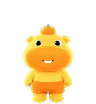
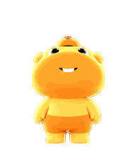

# 水豚噜噜桌宠 / Lulu Desktop Pet

以用户确认的噜噜形象为参考制作的非官方动画宠物素材与 Python 工具。


本版为美术修订版 3：去除所有突出的牙齿，闭嘴时使用细深色微笑，张嘴时保留深色内腔；丰富呼吸眨眼、手臂步态、挥手、起跳落地、失落恢复、等待、思考和检查时的细节动作。图集协议仍是 Pets v2（73 帧），美术修订号 3 不代表新的精灵图格式。




包含九种状态动画和十六个看向不同方向的姿势，共 73 帧。最终图集为透明 PNG，1536 × 2288 像素，8 列 × 11 行，每格 192 × 208 像素。

## 快速开始

需要 Python 3.10 或更新版本，在仓库根目录运行：

```sh
python -m venv .venv
# Windows PowerShell: .venv\Scripts\Activate.ps1
# macOS / Linux: source .venv/bin/activate
python -m pip install -r requirements.txt
python src/lulu.py check
python src/lulu.py build
python src/lulu.py render
```

重建的 PNG 和动画保存在 `build/`，该目录已加入 `.gitignore`。从仓库外运行脚本也能自动找到自带素材。

如需 MP4：

```sh
python -m pip install -r requirements-video.txt
python src/lulu.py render --mp4
```

## 内容

| 路径 | 内容 |
| --- | --- |
| `assets/spritesheet.png` | 本次美术修订的最终透明图集 |
| `assets/frames/` | 从最终图集无损提取的全部 73 帧，可编辑后重建 |
| `art/canonical-base.png` | 本次修订使用的无牙标准形象，保留生成时的洋红背景 |
| `art/source-strips/` | 各状态与方向的生成图稿，含原始洋红背景 |
| `art/layout-guides/` | 生成阶段的排布参考图 |
| `prompts/` | 本次准备提示词及实际使用的 used-*.md 提示词，包含修复记录 |
| `provenance/` | 本次请求、任务计划及带文件哈希的修订清单，已清理本机路径 |
| `qa/` | 创建阶段实际检查报告、人工方向语义记录、三份独立方向复核及汇总 |
| `previews/` | GIF、MP4 与动作静帧 |
| `docs/` | 完整接触表和方向检查图 |
| `src/lulu.py` | 独立运行的检查、图集重建与动画导出源码 |
| `tools/creation-history/` | 沿用此前制作中编写的原创辅助脚本；依赖见复现说明 |

## 图集布局

| 行（从 0 开始） | 状态 | 帧数 |
| --- | --- | ---: |
| 0 | idle：呼吸、眨眼 | 6 |
| 1 | running-right：向右奔跑 | 8 |
| 2 | running-left：向左奔跑 | 8 |
| 3 | waving：招手 | 4 |
| 4 | jumping：起跳、腾空、落地 | 5 |
| 5 | failed：失落及恢复 | 8 |
| 6 | waiting：等待输入 | 6 |
| 7 | running：专注思考、工作 | 6 |
| 8 | review：检查结果 | 6 |
| 9 | look-a：000° 至 157.5° | 8 |
| 10 | look-b：180° 至 337.5° | 8 |

前九行只使用从左开始的指定格数，其余 15 格完全透明。方向按屏幕坐标顺时针排列，000° 向上、090° 向右、180° 向下、270° 向左，中间每隔 22.5° 一帧。

## 修改与复现范围

- 编辑 `assets/frames/<状态>/<帧号>.png`，保持 192 × 208 RGBA，再运行 `build` 即可重建图集。
- `build` 使用已完成背景清理和配准的最终帧，不会重新调用图片生成服务。重建图集与发布图集的 RGBA 像素应一致，PNG 压缩字节可能不同。
- 角色与条带由图片生成工具生成；`prompts/used-*.md` 保存本次实际调用使用的提示词，其他文件是准备模板。`provenance/imagegen-jobs.json` 是创建计划，不能把其中的任务状态当作执行证明；实际验收以本次 `qa/` 报告为准。公开包只收录通过验收的源图，旧参考图及被拒绝图稿未收录；保留的提示词可能提及这些历史参考。生成服务有随机性，不能保证重新生成完全相同的图片。
- `src/lulu.py check` 只检查尺寸、透明通道和格子占用等结构。它不能替代创建时的语义、连续性、透明边缘检查或 Pets 官方预检。本次实际报告保存在 `qa/`；修改素材后需要重新检查。
- 创建时使用了 Pets 插件自带的提取、配准、组合及校验工具。未在本地插件目录找到这些工具的独立再分发许可，因此包内保留调用背景和本次编写的辅助脚本，不复制插件工具本身；这些外部工具不会随此仓库安装。`tools/creation-history/render_final_previews.py` 的 `--scripts` 参数需要原插件脚本目录；日常使用请运行独立的 `src/lulu.py`。
- 已移除账户宠物 ID、上传会话、下载链接和本机用户名路径；仓库不自动创建或选中账户中的宠物。

## 许可与来源

本仓库原创 Python 工具源码采用 [MIT 许可](LICENSE)。**MIT 不覆盖噜噜角色、角色衍生图像、动画和第三方参考。** 这些素材的状态与来源单列于 [ASSET_RIGHTS.md](ASSET_RIGHTS.md)。这是同人制作，并非官方授权项目。

## 上传 GitHub

项目仓库：[Perry88882/capybara-lulu-desktop-pet](https://github.com/Perry88882/capybara-lulu-desktop-pet)。

可以克隆仓库后按上面的说明运行；也可以在 GitHub 的 Code 菜单下载 ZIP。贡献前请先查看素材权利说明，勿将角色图片视作 MIT 授权素材。
